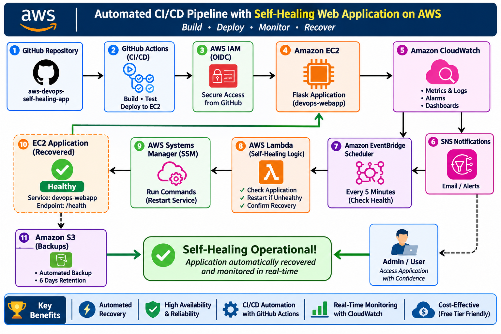

## AWS Architecture

The following diagram illustrates the complete architecture of the Automated CI/CD Pipeline with Self-Healing Web Application on AWS.

### Architecture Workflow

1. **Source Code:** Application code is maintained in GitHub.
2. **CI/CD:** GitHub Actions runs automated tests and deploys the application to EC2.
3. **Secure Authentication:** AWS IAM OIDC provides secure GitHub Actions access to AWS.
4. **Application Hosting:** Amazon EC2 hosts the Flask web application using Gunicorn.
5. **Monitoring:** Amazon CloudWatch collects system metrics and application logs.
6. **Notifications:** Amazon SNS sends email notifications.
7. **Automated Health Checks:** Amazon EventBridge Scheduler invokes Lambda every five minutes.
8. **Self-Healing:** AWS Lambda checks application health and uses AWS Systems Manager to restart the application when unhealthy.
9. **Backup:** Automated backup scripts create application archives and upload them to Amazon S3.